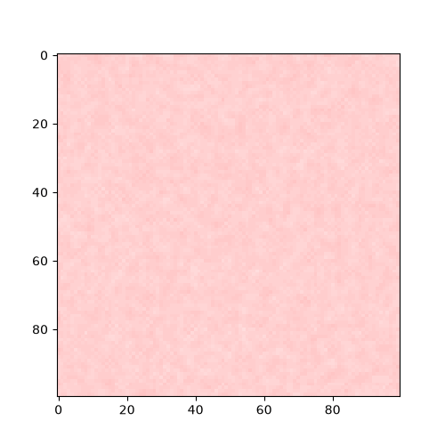

Hello all,

I had some time this weekend to play around with turing patterns.

Turing patterns are a sort of interesting geometric shape that naturally emerges when governed by two specific differential equations that model inhibitor and activator concentrations. These patterns can be seen everywhere in nature, most notably in the spots and patterns of various animals like leopards and some fish.

For now I'm a bit too busy to write up a detailed post on the specifics of turing patterns, so for now I'll leave you with a nice animation:

