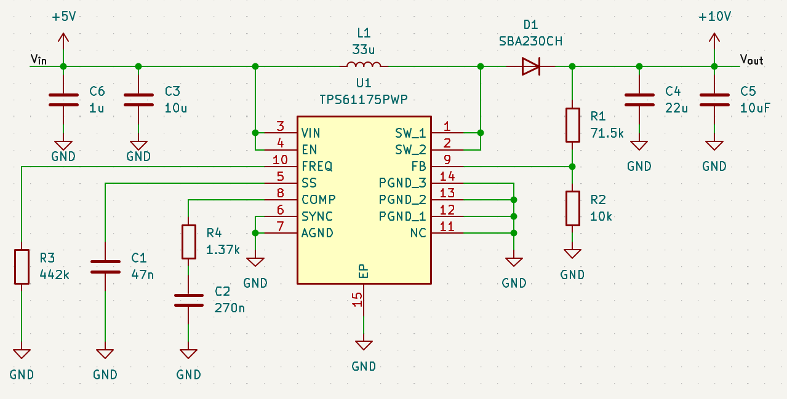
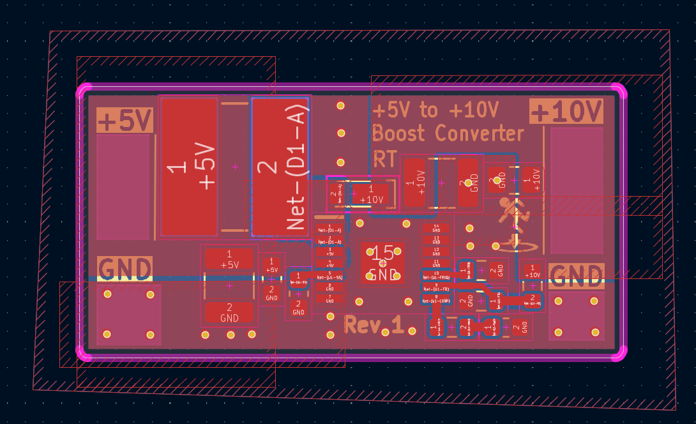
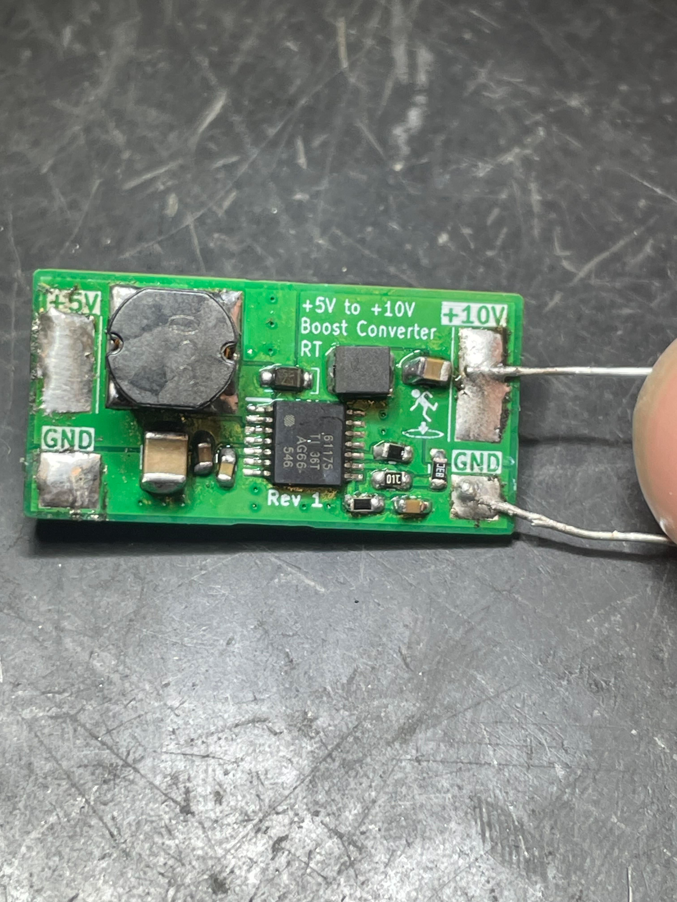

This year, for onboarding new members to the MIT Satellite Instrumentation subteam, I had everyone design a simple boost converter as a nice introduction to the electrical engineering design workflow.

Heres the schematic of the board I designed:

This board uses the TPS61175 boost converter IC from texas instruments. 

Heres the laid out and routed PCB. I made pretty heavy use of copper fill zones in this design. I think that boost converters are a pretty good beginner project for getting experience with designing PCBs for performance. Specifically, boost converters can be quite sensitive to the layout of the components, so its a good exercise in understanding parasitics and trace impedances.

	<model-viewer src="board.glb" ar ar-modes="webxr scene-viewer quick-look" camera-controls tone-mapping="neutral" poster="poster.webp" shadow-intensity="1" exposure="0.17" environment-image="legacy" auto-rotate style="width:100%; height:500px; background-color: #F0EAD6;"> </model-viewer>

And of course, this is what it looks like assembled (excuse the shoddy soldering as I soldered all these components with an iron before breakfast):

Upon powering up, I was pleased to see that the board indeed did not explode or release any magic smoke. It happily pushed out a clean 10V when hooked up to my bench power supply.

This post is pretty brief because I'm quite busy with midterms, so you can expect some time in the near future I'll update this page with more detailed noise ripple measurements and power spectra.